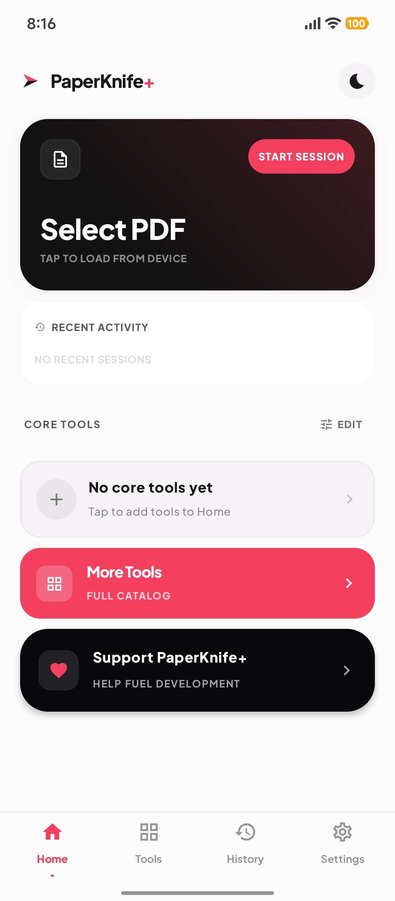
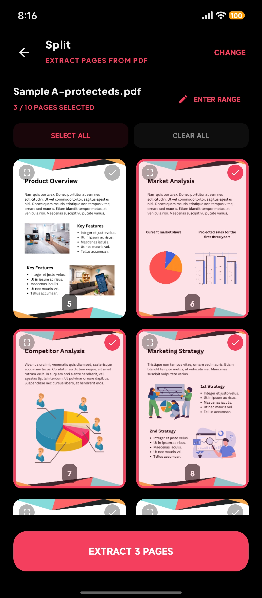
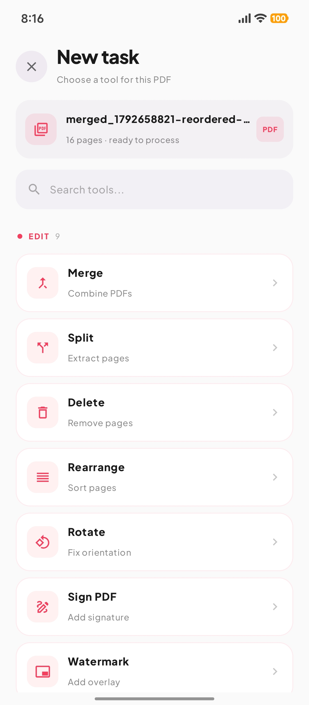
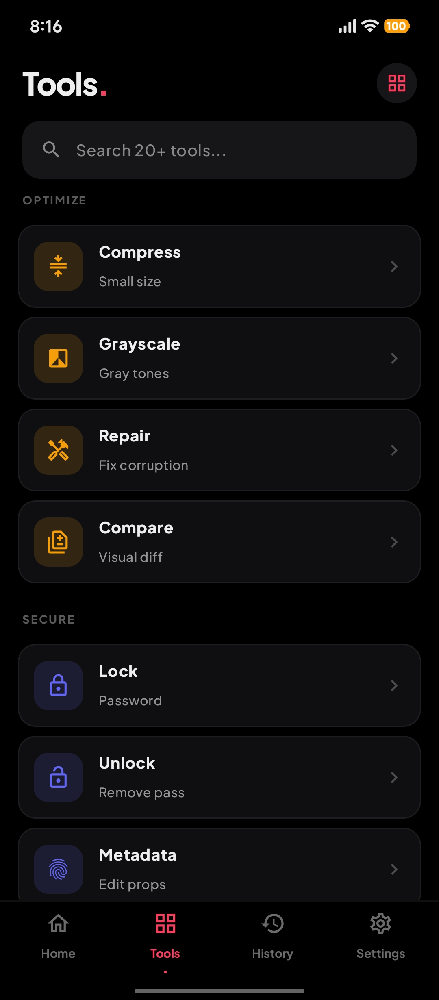

<div align="center">


<h1>PaperKnife+</h1>

<p><strong>A private PDF workshop for Android.</strong></p>

<p>21 tools. 100% offline. No accounts, no uploads, no tracking.</p>

<a href="https://github.com/potatameister/PaperKnifePlus/releases/latest">
  
</a>
<a href="https://apt.izzysoft.de/packages/com.paperknifeplus.app">
  
</a>
<a href="https://discord.gg/7538nAWYx">
  
</a>
<a href="https://x.com/potatameister">
  
</a>

</div>

---

## A quick look

<p align="center">
  
  
  
  
</p>

---

## Why PaperKnife+

Most PDF apps want your files on their servers. PaperKnife+ does the opposite.

Every tool runs on your phone using the native PDF engine. Your contracts, receipts, notes, and scans never leave your device. There is no account, no cloud, no analytics, and no INTERNET permission in the app.

It works on a plane, in a basement, or anywhere else with no signal.

---

## Tools

| Category | What you can do |
|---|---|
| **Edit** | Merge, split, delete pages, rearrange, rotate, sign, watermark, add page numbers, edit bookmarks |
| **Optimize** | Compress with estimated savings, grayscale, repair corrupted files, compare two PDFs |
| **Secure** | Lock with a password, remove passwords, edit metadata |
| **Convert** | PDF to images, images to PDF, PDF to ZIP, extract embedded images, PDF to text |
| **Viewer** | Find in document, print, pinch zoom, jump to page, open any tool directly on the current PDF |

---

## Download

**Latest release: v1.2**

<a href="https://github.com/potatameister/PaperKnifePlus/releases/latest">
  
</a>
<a href="https://apt.izzysoft.de/fdroid/index/apk/com.paperknifeplus.app">
  
</a>
<a href="https://f-droid.org/packages/com.paperknifeplus.app">
  
</a>

- **Android:** 7.0+ (minSdk 24)
- **Target:** Android 16 (API 36)
- **Size:** about 8 MB
- **License:** GPL-3.0-or-later

---

## Verify the APK

GitHub release APKs are signed with the PaperKnife+ signing key.

Signing certificate SHA-256:

```text
6B:AD:1D:71:9A:8B:B9:7C:73:FA:60:AA:08:B2:B0:D7:33:C7:75:3B:0F:C6:74:A1:30:6F:CD:94:62:23:8A:F8
```

Verify a downloaded APK with:

```bash
apksigner verify --print-certs PaperKnife+.apk
```

This confirms the signer identity. It does not verify the exact file contents. F-Droid builds are signed separately by F-Droid.

---

## Support PaperKnife+

PaperKnife+ is free, ad-free, and built in spare time. If it saves you a little work, you can help keep it going:

<a href="https://github.com/sponsors/potatameister">
  
</a>
<a href="https://liberapay.com/potatameister/">
  
</a>
<a href="https://buymeacoffee.com/potatameister">
  
</a>

<p align="center">
  <a href="https://potatameister.github.io/support">
    
  </a>
</p>

Every contribution helps keep PaperKnife+ free and offline. You can also help by reporting bugs, suggesting tools, sharing the app, or joining the [Play testing group](https://groups.google.com/g/paperknife-tester). After joining, opt in on [Google Play](https://play.google.com/apps/testing/com.paperknifeplus.app).

---

## Development

PaperKnife+ is built with:

- Kotlin + Jetpack Compose
- PDFBox-Android + Android `PdfRenderer`
- Coil with a custom PDF page fetcher
- MinSdk 24, compile/target SDK 36
- GitHub Actions for release builds

Build locally with JDK 17:

```bash
./gradlew assembleDebug
```

Issues and pull requests are welcome:

<a href="https://github.com/potatameister/PaperKnifePlus/issues">
  
</a>

---

## License

PaperKnife+ is free software under the **GNU General Public License v3.0 or later**.

See [LICENSE](LICENSE) for the full text.

<div align="center">

<strong>Made with care, entirely offline.</strong>

</div>
