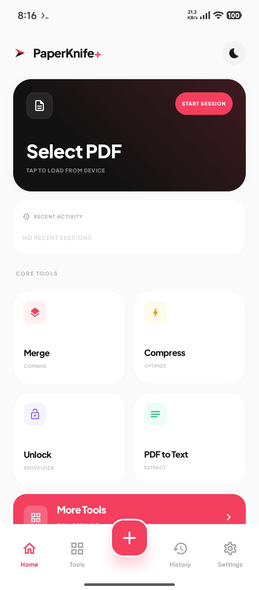
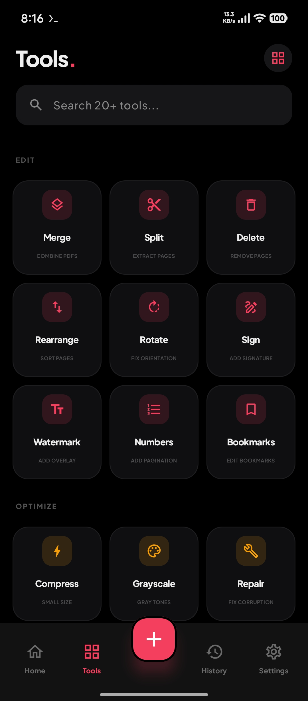
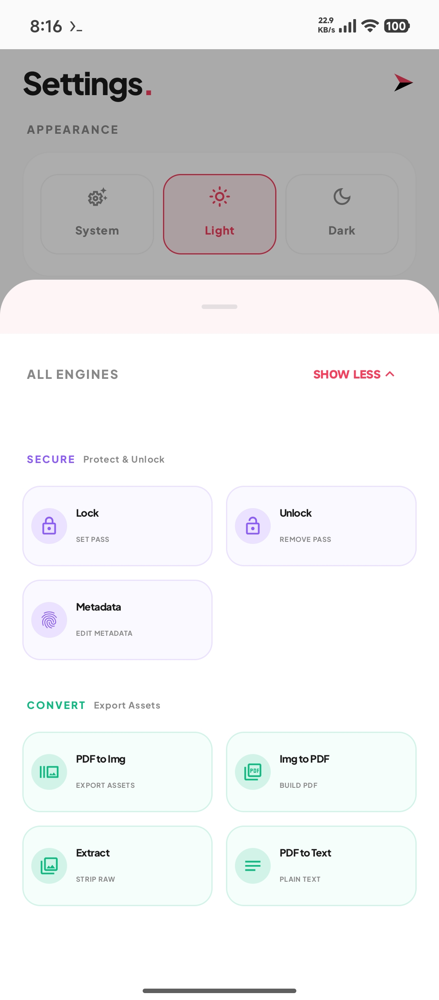
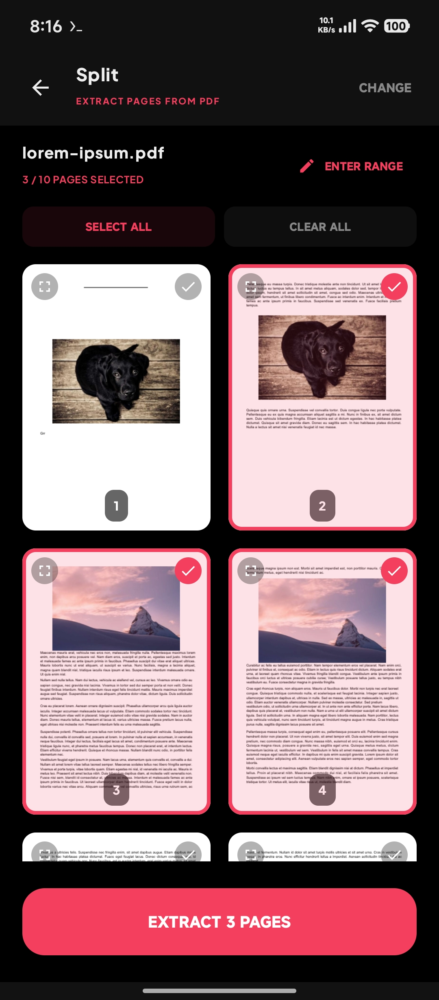

# PaperKnife+

A privacy-first PDF utility for Android. Works 100% offline - no internet, no trackers.

<a href="https://github.com/potatameister/PaperKnifePlus/releases/latest">
  
</a>
<a href="https://discord.gg/dSPXHWtHAX">
  
</a>
<a href="https://x.com/potatameister">
  
</a>

---

## Screenshots

<p float="left">
  
  
  
  
</p>

---

## Features

- Merge & Split PDFs
- Password protect your PDFs  
- Convert Images to PDF
- Export PDF pages as Images (ZIP)
- Rotate and rearrange pages
- And more!

All processing happens on your device. Your files never leave your phone.

---

## Download

Get the latest APK: [PaperKnife+ v1.1](https://github.com/potatameister/PaperKnifePlus/releases/latest)

<a href="https://apt.izzysoft.de/fdroid/index/apk/com.paperknifeplus.app">
  
</a>
<a href="https://f-droid.org/packages/com.paperknifeplus.app">
  
</a>

---

## Verify the APK

Signing certificate SHA-256 for GitHub release APKs:

```text
6B:AD:1D:71:9A:8B:B9:7C:73:FA:60:AA:08:B2:B0:D7:33:C7:75:3B:0F:C6:74:A1:30:6F:CD:94:62:23:8A:F8
```

Verify a downloaded APK with:

```bash
apksigner verify --print-certs PaperKnife+.apk
```

This confirms the APK was signed by the PaperKnife+ signing key. It verifies the signer, not the exact file contents.

---

## Support

<a href="https://github.com/sponsors/potatameister">
  
</a>
<a href="https://potatameister.github.io/support">
  
</a>

---

## License

GPL-3.0-or-later
